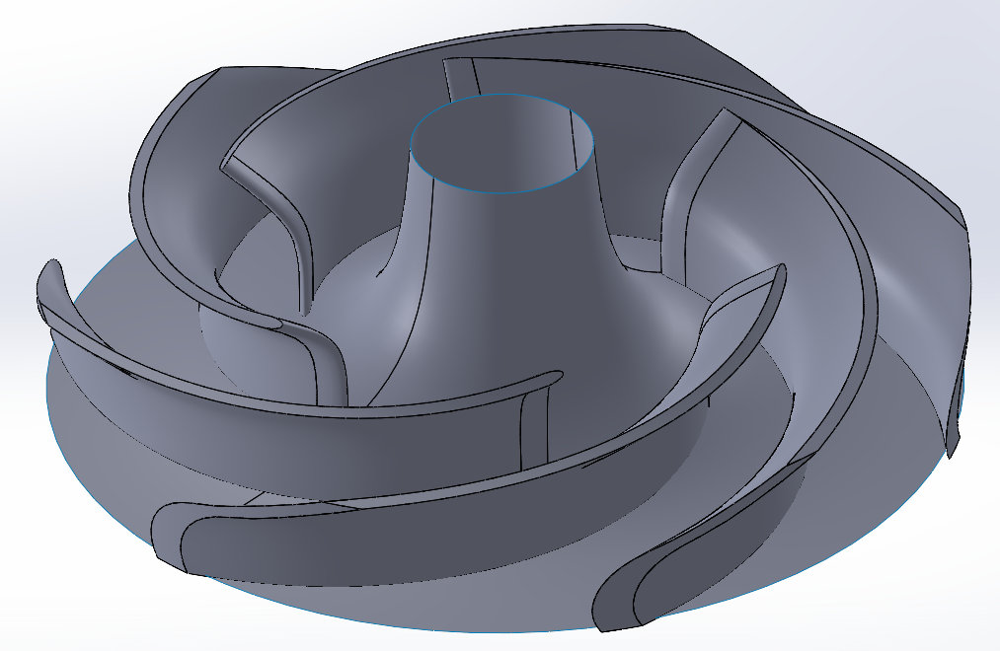

# Centrifugal Pump Impeller Design

A turbomachinery coursework project by **Pouya Asghari and Niloufar Fattahi**, combining analytical impeller sizing, single-arc and double-arc blade construction in SolidWorks, and three-dimensional impeller design in CFturbo.

The project uses a Pumpiran catalog duty point of **125 m³/h**, **13.5 m head**, and **1450 rpm**. This repository contains the English report, editable LaTeX source, original report figures, native CFturbo and SolidWorks files, a STEP export, and the CFturbo-generated SolidWorks macro.



## Project scope

The work follows two phases:

1. **Analytical design and blade construction:** select the reference duty point; calculate specific speed, theoretical head, velocity triangles, and principal dimensions; construct six-blade profiles using single and double arcs.
2. **CFturbo design and CAD transfer:** configure the duty point and main dimensions; shape the meridional passage, blade angles, thickness, mean lines, and edge profiles; inspect preliminary design indicators and export geometry for CAD use.

The included material documents design calculations, CAD construction, and preliminary CFturbo estimates. No separate CFD mesh, solver case, residual history, experimentally validated pump curve, or resolved cavitation dataset is included.

## Reference design inputs

| Parameter | Preliminary design value |
| --- | ---: |
| Flow rate | 125 m³/h |
| Head | 13.5 m |
| Rotational speed | 1450 rpm |
| Fluid density | 1000 kg/m³ |
| Blade count | 6 |
| Catalog reference efficiency | 84.5% as quoted in the original report |
| Assumed hydraulic efficiency | 90% |
| Assumed volumetric efficiency | 96% |
| Preliminary outlet diameter | 209 mm |
| Preliminary eye diameter | 125 mm |
| Hub diameter | 45 mm |
| Preliminary inlet / outlet metal angles | 25° / 35° |

The catalog efficiency and assumed hydraulic efficiency are different quantities. Neither is a measured performance result for the new design.

## Preliminary design versus saved model

The archive includes different design stages. The hand calculations should not be described as identical to the final saved CFturbo state.

| Quantity | Preliminary report | Stored CFturbo project |
| --- | ---: | ---: |
| Outlet diameter | 209 mm | 225.8 mm |
| Outlet width | 32 mm | 34.55 mm |
| Eye / suction diameter | Eye assumed 125 mm | Suction-diameter field 132.5 mm |
| Hub diameter | 45 mm | 45 mm |
| Blade count | 6 | 6 |
| Span count in CFturbo stage | 7 | 7 |
| Blade form in CFturbo stage | Free-form 3D | FreeForm |

The stored values were read from the supplied XML project; the geometry has not been independently regenerated. The English report's editorial appendix also documents angle and thickness differences, the distinction between a DN 125 suction connection and the shaft diameter, and small calculation discrepancies.

## Repository files

| Path | Contents |
| --- | --- |
| [report/main.pdf](report/main.pdf) | English report with equations, original figures, and editorial review |
| [report/main.tex](report/main.tex) | Editable LaTeX source |
| [report/BUILD.md](report/BUILD.md) | Local and Overleaf compilation instructions |
| `report/figures/` | Original figures, screenshots, catalog extracts, and cover logos |
| [cad/CFTurbo/Proj1.cft](cad/CFTurbo/Proj1.cft) | Native CFturbo project; recorded version 10.4.5.27 |
| [cad/CFTurbo/Proj1.stp](cad/CFTurbo/Proj1.stp) | STEP geometry export |
| [cad/CFTurbo/Proj1.swb](cad/CFTurbo/Proj1.swb) | SolidWorks geometry-generation macro exported by CFturbo |
| [cad/Solidworks/Part1.SLDPRT](cad/Solidworks/Part1.SLDPRT) | Original SolidWorks part |
| [cad/Solidworks/Part2.SLDPRT](cad/Solidworks/Part2.SLDPRT) | Original SolidWorks part |
| `cad/Solidworks/Junk/` | Two additional part files retained under their original archive folder name |
| [cad/OPENING_FILES.md](cad/OPENING_FILES.md) | Instructions for opening the CAD files and using the macro |
| [docs/REVIEW_NOTES.md](docs/REVIEW_NOTES.md) | Technical scope, terminology, and design-stage review |
| [docs/PROVENANCE.md](docs/PROVENANCE.md) | File provenance and translation notes |
| [docs/SHA256SUMS.txt](docs/SHA256SUMS.txt) | Checksums of the unchanged original CAD files |

The generic part filenames do not establish which blade-construction method they represent; that mapping needs confirmation in SolidWorks.

## Opening the project

- **CFturbo:** open a copy of `cad/CFTurbo/Proj1.cft` in a compatible installation. Its stored version is 10.4.5.27. Check automatic calculations before saving in a newer release.
- **SolidWorks:** open the supplied `.SLDPRT` files in a compatible SolidWorks installation, or import the STEP export using File → Open.
- **SolidWorks macro:** `Proj1.swb` is an ASCII geometry-generation macro with a `main` entry point. In a compatible release, use Tools → Macro → Run and select it. It requires SolidWorks and is not a standalone simulation program.
- **Report only:** read the PDF without any CAD software.

See [the CAD guide](cad/OPENING_FILES.md) for the complete workflow. Native CAD applications were not available for execution validation during preparation of this package. No application installers are included.

## Build the English report

In Overleaf, upload the complete package ZIP, select `report/main.tex` as the main document, and use **pdfLaTeX**.

For a local TeX Live or MiKTeX installation, run from the repository root:

```bash
cd report
pdflatex -interaction=nonstopmode -halt-on-error main.tex
pdflatex -interaction=nonstopmode -halt-on-error main.tex
```

The LaTeX report needs only `report/main.tex` and its `figures/` folder, together with standard LaTeX packages. No custom font, bibliography file, or CAD application is required to compile it. The PDF was successfully compiled with TeX Live 2023.

## Limitations and next steps

- Reconcile the hand-design dimensions, intermediate screenshots, and final stored CFturbo values before claiming an exact reproduction of the catalog impeller.
- Distinguish the empirical NPSHr estimates from a cavitating CFD simulation.
- Verify the imported STEP geometry and body topology before meshing or manufacturing.
- Confirm the purpose of each generically named SolidWorks part.
- Record the SolidWorks version and confirm the coauthor's preferred English name spelling.
- Add a downstream CFD study or experimental validation separately if performed later.

## Academic context and attribution

Prepared for **Turbomachinery**, taught by **Dr. Riasi**, School of Mechanical Engineering, College of Engineering, University of Tehran, second semester of academic year **1404–1405** (Iranian calendar).

The source report credits **Pouya Asghari** and **نیلوفر فتاحی**, transliterated here as **Niloufar Fattahi**. Individual contributions were not specified and have not been inferred.

The English translation and LaTeX conversion were prepared with AI assistance. Original CAD file bytes and report screenshots were preserved. The catalog figures originate from the Pumpiran catalog extracts embedded in the source report; the complete catalog and the unspecified course reference book were not included in the archive.

## License

No license has been selected. A project license can be added after the authors decide the intended reuse permissions. Third-party catalog figures and software interface images retain their original attribution.
